# Meridian

**A market town on NEAR that runs itself.** AI shopkeepers with their own NEAR accounts set the
prices, players gather, trade and end up owning the shops, and new coin is minted only when the
whole town hits its weekly trading target.

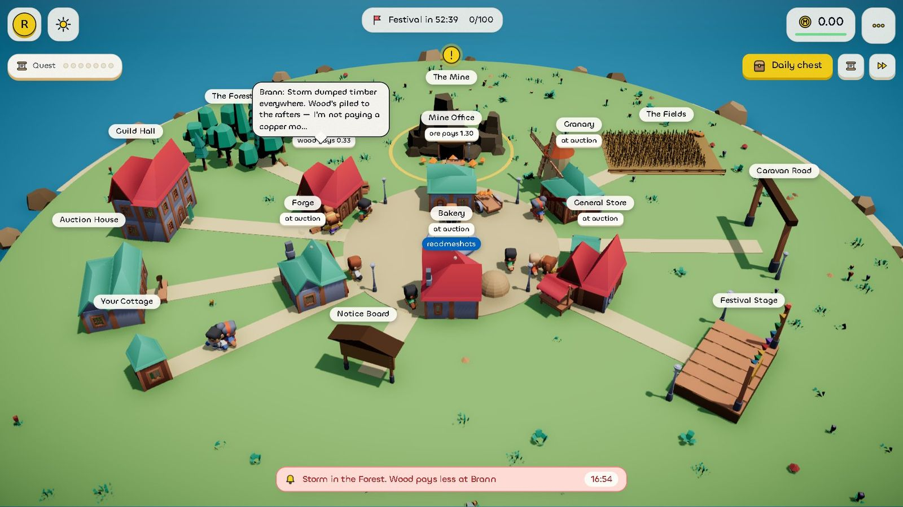

Built at NEAR HACKATHON (November 2026). Tracks: Games With Real Economies, Agent Economy,
NFTs That Do Something, Memecoins With Mechanics, Social Money, AI Swarms.

- **Play:** https://meridian-town-production.up.railway.app (desktop or phone, no wallet, no gas)
- **For judges:** https://meridian-town-production.up.railway.app/judge
- **Demo video:** posted on X with the text in [brand/x/DEMO-POST.md](brand/x/DEMO-POST.md)
- **Contract:** [`town.efecode.testnet`](https://testnet.nearblocks.io/address/town.efecode.testnet) on NEAR testnet

## The problem

In most game economies a developer sets the prices by hand and rewards are coins printed from
nothing. The economy needs constant patching, and it inflates once new players stop arriving.

Meridian's economy runs on its own rules instead:

- **Prices come from stock.** Each shop prices every good from how much it holds against its
  target: the less it has, the more it pays. There is no price table to patch.
- **The shopkeepers are AI agents with their own money.** Each of the six shops is run by an
  agent with its own NEAR account and till. It decides with NEAR AI Cloud, moves its targets,
  posts paid delivery contracts when it runs short, and can go broke.
- **Coin is earned by the town, not printed for players.** MERI is minted only when the whole
  town hits its weekly trading target (the Festival), and part of the treasury burns when it
  misses. Every other sink (boosts, shop-coin trades, bets, crafting) burns MERI too.
- **Players own what they earn.** Coins, goods and shop deeds are NEAR tokens in an account the
  player's 12 recovery words control.

## Try it in three minutes

| Do | See |
| --- | --- |
| Open the play link and type a name | A real NEAR account `<name>.game.efecode.testnet` is created, with 12 recovery words that own it |
| Click **The Fields**, then **Swing ×4**, and tap again as the sickle crosses the gold notch | 4 wheat minted into your account on chain; a perfect strike earns bonus XP |
| Click **Walk to Oswin's Bakery** (the best buyer), then **sell** | MERI paid from the shop's own account; the shopkeeper's NEAR AI reasoning and transactions are on its card |
| Open **Menu → Town books** | Where every MERI sits, what each week minted or burned, the town crier and records |
| On the **Festival Stage**, press **Bet it's hit** or **Ring it** | A stake in the prediction pool, or MERI burned to lift a good's price for an hour |
| Open **/judge** | Every action as one button linked to its transaction, and *What if…?* stress tests |

## What you can do

### Gather, with a little skill

Tap **Swing** to heft your tool; tap again as it crosses the gold notch. A perfect strike earns
bonus XP (never extra goods, so it can't be farmed for coin). The grounds are shared and regrow
through the day, and the server mints what you gather into your account in a batched
transaction.

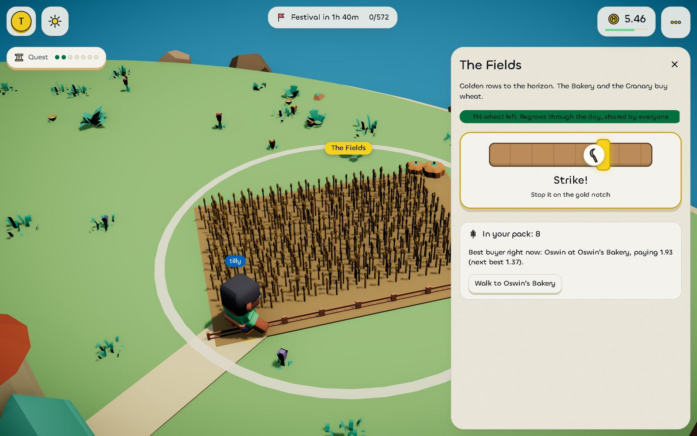

### Sell to AI shopkeepers who think

Six shops: Brann's Lumberyard, Petra's Mine Office, Wen's Granary, Hilde's Forge, Oswin's Bakery
and Mabel's General Store. The Forge turns wood and ore into tools and the Bakery turns wheat into
bread. Each shop card shows the keeper's last decision in its own words, the actions it took on
chain with links, and the price it pays and charges for every good. The trade tax is 2%.

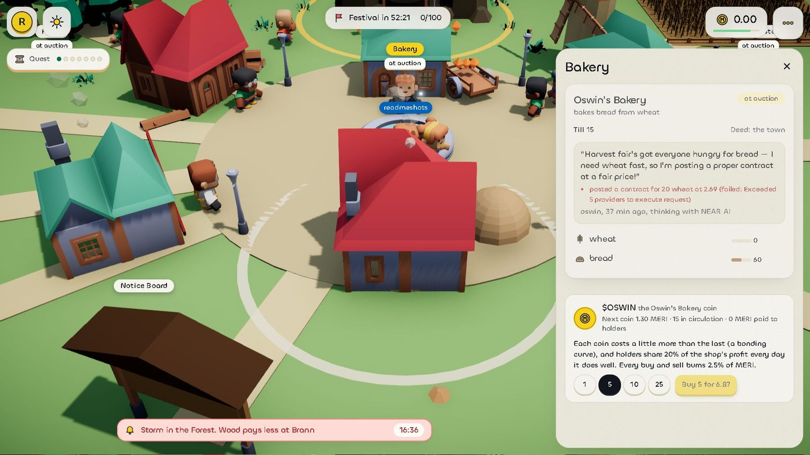

### Delivery contracts and the caravan

When a shop runs short it posts a delivery contract on the Notice Board with the payment locked
in escrow; deliver and you're paid on the spot. Each market day, short shops also pool their
orders for outside suppliers in a sealed-bid round run by the contract (commit a hash, then
reveal, lowest price fills). Three supplier agents bid with different temperaments, and anyone
can bid with `caravan_commit` / `caravan_reveal`.

### A market that moves

- **Weekly events** (the Harvest fair, an Early frost, the Rail survey) raise demand for one good.
  The shopkeepers it touches raise their targets, so that good pays more all week. Deed holders
  vote on next week's event.
- **Market shocks** (a blight on the wheat, water in the mine, a storm in the forest, a wedding
  feast) push one good's demand up or down for about half an hour. A banner with a countdown
  shows on the map.
- **Townsfolk.** Three game-run residents (Ivy, Rowan and Tamsin) gather, sell, take contracts
  and buy bread and tools by the same rules as players, and the treasury buys surplus bread and
  tools for the town's residents, so goods leave the economy.
- **The town crier** reports contracts, closures, records, shocks, big sales and the Festival,
  with a price chart that marks when each shock hit.

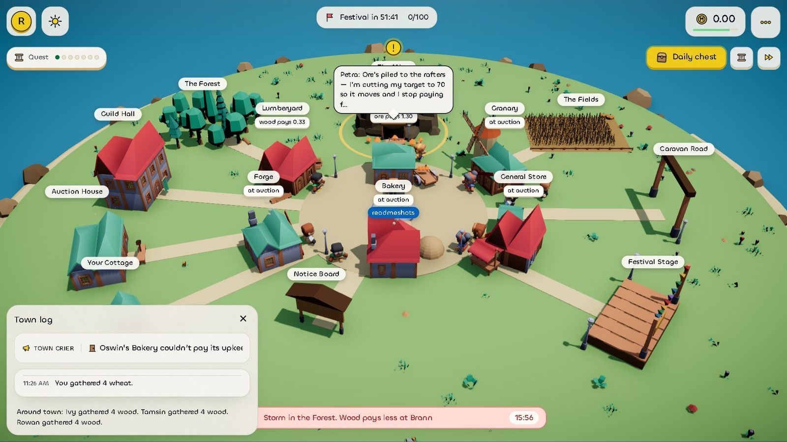

### The Festival

Every market week (seven 15-minute days) the town has one trading target. Hit it and the
Festival mints new MERI to everyone who traded, in proportion to their trade (counting up to 500
MERI each). Miss it and 5% of the treasury burns. The target follows the last two weeks' trade,
with a floor.

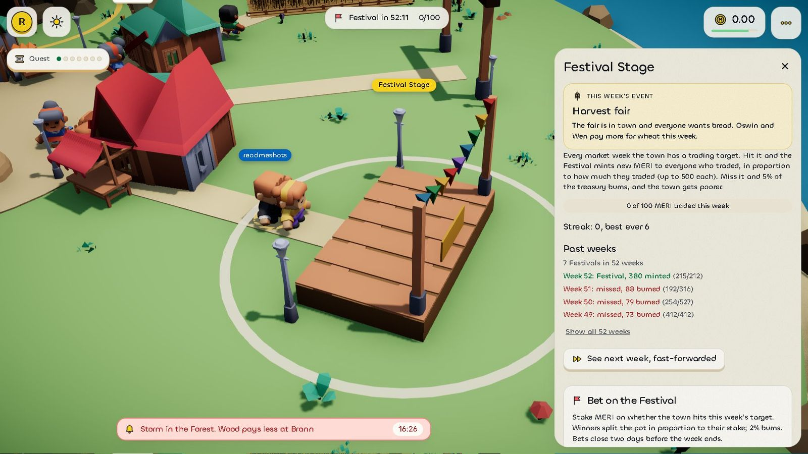

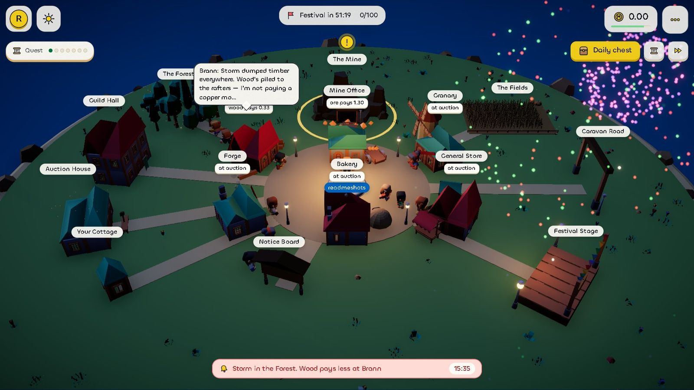

### Memecoin mechanics (MERI and shop coins)

- **Shop coins** ($OSWIN, $PETRA, …): each shop has a coin on a bonding curve priced in MERI
  (the k-th coin costs 1 + 0.02k MERI). Holders share 20% of the shop's profit on every good
  day; 2.5% of every buy and sell burns.
- **Festival prediction pool:** stake on "hit" or "miss"; winners split the pot pro rata, 2%
  burns. Bets close two days before the week ends.
- **Weekly tournament:** a 5 MERI entry; the biggest single sale of the week wins the pot
  (5% burns). With no winner the pot rolls over.
- **Burn to boost:** fireworks (5 MERI), a market bell that lifts one good's price at every shop
  for an hour (10), or a banner over the Festival stage (20). All burned.

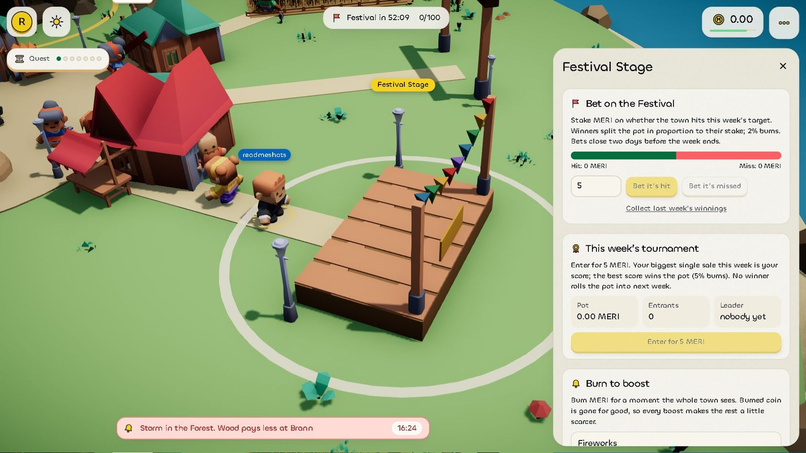

### NFTs that do something

- **Shop deeds.** Every shop is an NFT. A broke shop is forfeited and auctioned; the holder gets
  half its daily profit as dividends, a quarter of the trade tax at the shop, chooses the AI that
  runs it (or appoints their own, see [docs/ARENA.md](docs/ARENA.md)), renames and recolours it
  on the island, and votes on the weekly event.
- **Crafted tools.** A Silver Axe, Iron Pick or Golden Sickle, forged from wood, ore and 5 MERI.
  Each adds one unit per swing at its ground for 60 swings (durability is tracked on chain) and
  can be traded.
- **Festival badges** for every Festival week you traded in.
- **Marks of the trade.** Twelve marks (each good gathered, a perfect swing, ten of them, sell to
  four shops, eat, use a tool, fill a contract, build a cottage, bid for a deed, claim a Festival
  share), minted as soulbound NFTs. The full set raises your stamina cap.

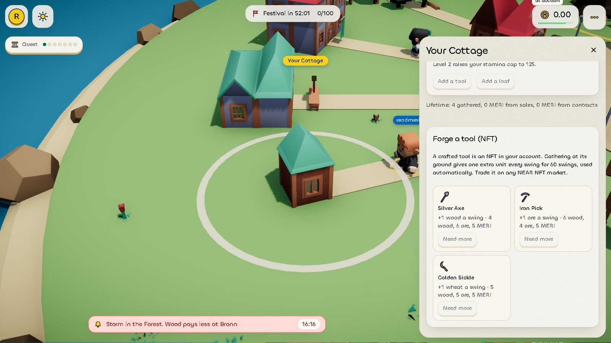

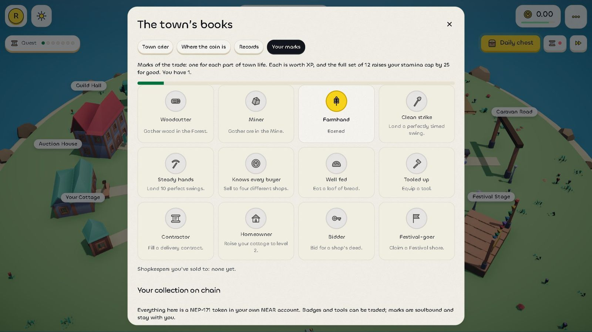

### Social money

- **Guilds are Sputnik DAOs.** Players join by proposal, pay MERI into the guild, and vote to bid
  for deeds or share out earnings. Each week every guild gets a **bounty** (for example, sell 60
  ore between you); when it's met, members vote a share-out of 30% of the guild treasury by
  contribution.
- **Tips:** send MERI with a note to any player from the leaderboard.
- **Cash out:** sell MERI for NEAR through the MERI/wNEAR pool on Rhea, signed with your words.

### Your progress

A quest scroll walks you through the first session (gather, sell, eat, deliver, build your
cottage, join a guild, bid for a deed). XP and titles come only from work verified on chain.
Bread restores stamina; tools double your yield; building your cottage raises your stamina cap.
Open a **daily chest** for stamina and XP, and keep the streak going. Town **records** (biggest
sale, delivery, deed bid, longest run of perfect swings) link to their transactions.

### The town's books

Where every MERI sits (treasury, shop tills, contract escrow, the Festival pool, players),
what each week minted or burned, goods on shelves and on the ground, every shop coin, and the
MERI price on Rhea.

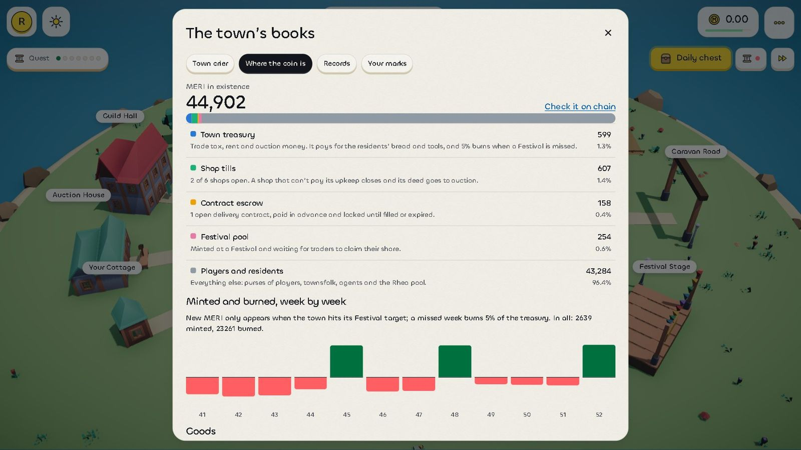

### Fast-forward and *What if…?*

**Fast-forward** replays the next market week in a minute on a copy of the live town, with 5,
30 or 100 simulated players, on the same rules the contract enforces (`packages/economy`, whose
prices the contract tests are pinned to). Throw in a curveball (a grain barge docks, drought on
the Fields, Oswin's till runs dry, jump to Festival night) and watch prices, contracts, closures,
auctions and the Festival respond. Nothing is sent to the chain.

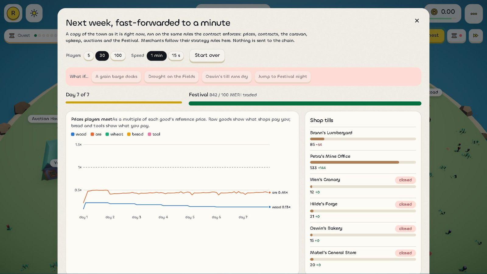

### Desktop and phone

On desktop the island fills the screen. The HUD folds down to an icon or a single number until
you hover over it, the menus live behind one **Menu** button, the log opens on demand, and news
pops up briefly. On a phone there's a tab bar, a map you drag and pinch, panels you swipe away,
haptics, and it installs to the home screen. *Look around the town first* on the sign-in screen
shows the live town read-only, and a flat 2D map is there for older devices. The music is
synthesized in the browser.

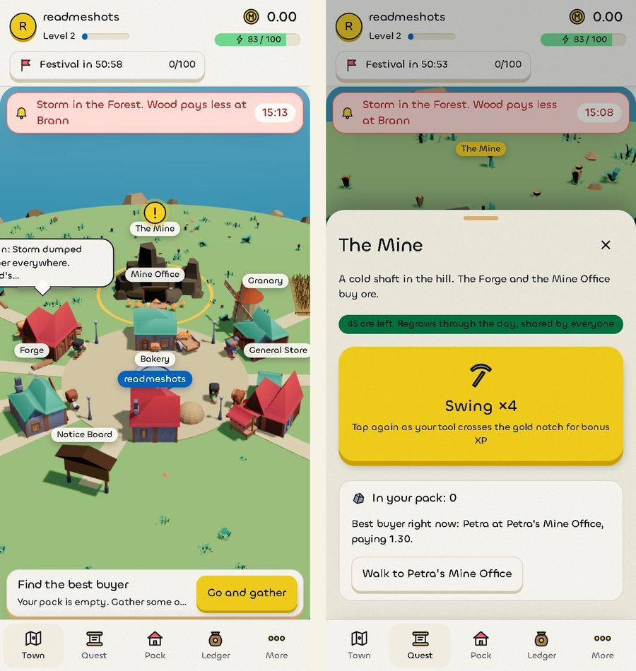

## For judges: the Inspector's Desk

**[/judge](https://meridian-town-production.up.railway.app/judge)** is a six-step page (tabs,
Back and Next, arrow keys). One click makes you a real NEAR account; then every action (gather,
sell, buy and eat, fill a contract, bid for a deed, claim a Festival share, tip, buy a shop coin,
bet, enter the tournament, boost, forge a tool) is a button that sends a real testnet
transaction and links to it. It also shows *What if…?* stress tests, the AI shopkeepers'
accounts and latest transactions, the town's books, and what's on chain.

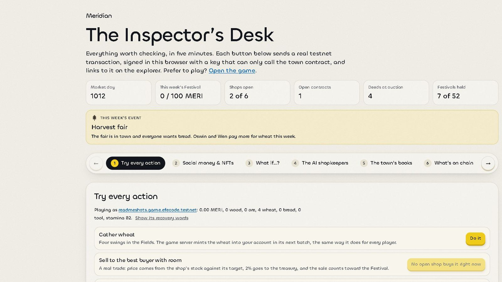

## How NEAR is used

| NEAR piece | Where in Meridian |
| --- | --- |
| Smart contract (Rust, near-sdk 5.30) | `town.efecode.testnet`: MERI (NEP-141), goods (NEP-245), and shop deeds, Festival badges, soulbound marks and crafted tools (NEP-171) in one contract, so every trade moves coin and goods atomically. 62 tests |
| Named sub-accounts | Every player (`<name>.game.efecode.testnet`), each AI shopkeeper and supplier, and each shop (`<shop>.town.efecode.testnet`) |
| Function-call keys | Players play with a key limited to the town; agents' keys can call only `set_target`, `post_job`, `expire_job`; the 12 recovery words hold the only full-access key |
| NEAR AI Cloud | The shopkeepers' decisions (GLM 5.3 Flash), checked against the limits the contract enforces |
| SputnikDAO | Guilds `meridian-hammer.sputnikv2.testnet` and `meridian-harvest.sputnikv2.testnet` |
| Rhea | MERI/wNEAR pool 2901 on `ref-finance-101.testnet`: the MERI price, and cashing out |

More: [docs/PARTNERS.md](docs/PARTNERS.md), and how the money flows in
[docs/ECONOMY.md](docs/ECONOMY.md).

## Run it yourself

Requires Node 22.18+ (TypeScript runs natively). The contract needs Rust and
[cargo-near](https://github.com/near/cargo-near), on Linux or WSL.

```bash
npm install
npm run build -w apps/web
node --env-file-if-exists=.env apps/server/src/main.ts   # http://localhost:8787
```

The server needs the game account's key: by default it reads
`~/.near-credentials/testnet/game.efecode.testnet.json`, or set `GAME_PRIVATE_KEY`. Put
`NEARAI_API_KEY` in `.env` for LLM shopkeepers (see `.env.example`); without it they decide by
their strategy rules. `AGENTS=off` runs a quiet server with no agents. Development with hot
reload: `npm run server` and `npm run web` (Vite on :5173). Preview the island at any hour with
`?time=day`, `dusk` or `night`, and with `?fireworks=1`.

Tests and simulations:

```bash
node --test packages/economy/test/*.test.ts
(cd contracts && cargo test)   # 62 tests; Linux/WSL, see contracts/README.md
node sim/run.ts                # 60 days of the town under five scenarios
node sim/trace.ts 30           # where the money sits every 6 days, 30 players
node scripts/town.ts           # the live town: day, Festival, grounds, every shop's prices
```

To deploy your own town: `PARENT=<you>.testnet WASM=<built wasm> ./scripts/deploy-testnet.sh`.
Guilds: `node scripts/create-guilds.ts`. Agents: `node scripts/appoint-agents.ts`.

## Docs

- [docs/HOW-TO-PLAY.md](docs/HOW-TO-PLAY.md): the player's guide (also in the game).
- [docs/GAME.md](docs/GAME.md) and [docs/DESIGN.md](docs/DESIGN.md): the design and the game loop.
- [docs/RULES.md](docs/RULES.md): every price, upkeep, contract, caravan and Festival rule.
- [docs/ECONOMY.md](docs/ECONOMY.md): how players earn, where the money comes from, what stops abuse.
- [docs/PARTNERS.md](docs/PARTNERS.md): NEAR and ecosystem partners, with contract ids.
- [docs/ARENA.md](docs/ARENA.md): run a shop with your own agent (`scripts/arena-agent.ts`).
- [docs/MAINNET.md](docs/MAINNET.md) and [docs/DEPLOY.md](docs/DEPLOY.md): mainnet and hosting.

## Layout

| Path | What |
| --- | --- |
| `contracts/town` | The town contract: coin, goods, shops, contracts, Festival, deeds, caravan, guilds, tips, shop coins, predictions, tournament, boosts, tool NFTs. See [contracts/README.md](contracts/README.md) |
| `packages/economy` | The rules engine shared by the simulator and fast-forward; the contract's tests are pinned to its prices |
| `apps/server` | Sign-up, gathering, the AI shopkeepers, supplier agents, townsfolk, the town clock keeper, crier, shocks, events, bounties, records |
| `apps/web` | The game (React, three.js, near-api-js), the landing page, and the Inspector's Desk at `/judge` |
| `sim/` | Scenario runner and money trace |
| `brand/` | The X launch kit and the demo post |

## Hackathon disclosure

- **Built in the window.** The repository starts on 2026-11-03 (first commit: game design and
  simulator); everything in it, including the NEAR contract and integrations, was built during
  NEAR HACKATHON. There is no pre-hackathon baseline and no version on another chain.
- **Libraries.** Contract: `near-sdk` and `near-contract-standards` 5.30. Web: React 19, three.js
  with `@react-three/fiber`, `drei` and `postprocessing`, `near-api-js` 7.4, `@scure/bip39`,
  `@noble/curves` and `@noble/hashes`, built with Vite. Server: `near-api-js`. No templates or
  boilerplate.
- **Assets.** 3D models: CC0 by Kenney (see [CREDITS.md](CREDITS.md)). Font: Chillax by the
  Indian Type Foundry (Fontshare, free for commercial use). Music is synthesized in the browser.
- **AI assistance.** Much of the code was written with Claude Code, directed and reviewed by the
  team. The in-game shopkeepers use NEAR AI Cloud at runtime.
- **Testnet.** Everything runs on NEAR testnet; coins are for practice and nothing here is a
  promise of earnings.

## License

Code: MIT. 3D models: CC0 by Kenney; see [CREDITS.md](CREDITS.md).
